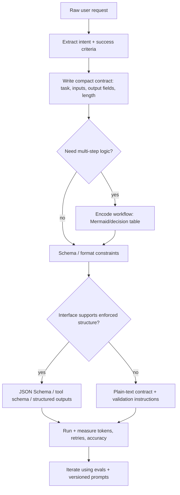
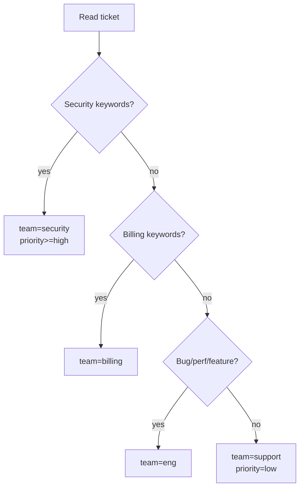

# Prompt Concision and Token Efficiency: Recent Techniques and Visual Prompting Patterns

## Executive summary

Across the last stretch of platform and research updates, “prompt concision” has shifted from wordsmithing to **contract design**: you get the biggest practical wins by replacing prose with *structures that the model can’t easily misread*—schemas, graphs, constrained tool calls, compact state packets—and then using platform features to keep repeated structure cheap and stable. citeturn19view0turn17view0turn31view0turn22view0turn13view0turn5view1

Three trends dominate the practical playbook:

- **Schema-first outputs** (strict JSON Schema / structured outputs) reduce ambiguity and retry loops by making format requirements enforceable, not “politely requested.” citeturn19view0turn21view0  
- **Context economics** (prompt caching, compaction, and context-engineering patterns) move token spend from “every turn” to “amortized/managed,” while explicitly acknowledging that long context degrades reliability and cost. citeturn17view0turn31view0turn22view0turn29view0  
- **Visual or semi-visual prompting** (Mermaid DAGs/flowcharts/decision graphs, sometimes as an intermediate representation) is no longer just “nice documentation”; multiple recent papers and vendor workflows treat diagrams as a *machine-readable control surface* for bounded reasoning and verifiable workflow planning. citeturn5view1turn8view1turn11view1

The uncomfortable but useful conclusion: **you often reduce tokens most by reducing *mistakes***—fewer clarifying turns, fewer retries, fewer “almost-JSON” failures—rather than by shaving a few words. That’s why techniques that *constrain* behavior (schemas, graphs, tool contracts, compaction) tend to dominate token ROI. citeturn19view0turn31view0turn17view0turn22view1turn13view0

## Recent shifts driving new best practices

### Contract enforcement moved into mainstream APIs

In the last cycle, strict structured outputs became a first-class primitive in major ecosystems: the model is constrained to a **JSON Schema** so it can’t “forget a key” or output an invalid enum value, and vendors explicitly market this as simpler prompting and reliable type-safety. citeturn19view0turn21view0turn21view2

That changes how you should write prompts: the prompt shrinks to “extract X,” while the schema carries the real contract. But there’s a catch—**schema mismatch can induce hallucinations** unless you explicitly define what to do when the input can’t fit the schema. citeturn19view0

### “Cost control” became a routing and state-management problem

Two platform patterns matter more than micro-editing:

- **Prompt caching**: identical prefixes can get large latency/cost reductions, but only for exact prefix matches; static content must be placed up front. Prompt caching is automatic once prompts cross a threshold (and has configurable retention policies). citeturn17view0turn15view0  
- **Compaction**: as conversations grow, compaction reduces context size while preserving state via an opaque compaction artifact, with both server-side and standalone API patterns. citeturn31view0turn29view0

This is where I’ll argue with myself and then audit it: it’s tempting to assume that “conversation state” (chaining with a previous response ID) saves tokens. It *does* save you from rebuilding context client-side, but **it does not save billed input tokens** in the typical billing model; prior tokens in the chain remain billed. Real token reduction comes from *compaction, pruning, and better context selection*, not from state references alone. citeturn29view0turn31view0

### Visual intermediate representations became “bounded reasoning” tools

Recent research treats Mermaid graphs as a way to compress workflows into high-density tokens and constrain reasoning paths:

- **Bounded reasoning via Mermaid instruction graphs** is presented as a method to replace free-form chain-of-thought with deterministic graph traversal, with claimed accuracy and efficiency benefits. citeturn5view1turn5view2turn5view3  
- **Mermaid-based workflow representations** are framed as statically verifiable and compiler-like, supporting safe rewrites and modular composition in agentic planning. citeturn8view1turn8view2  
- Multimodal tooling is emerging that converts *existing flowcharts* into Mermaid code and warns that models can hallucinate/misinterpret diagram elements—meaning “visual prompting” is powerful but not automatically reliable. citeturn11view0turn11view1

## Technique catalog with comparisons

The table below synthesizes recent vendor guidance and research into practical techniques aimed at: (a) making prompts shorter, (b) reducing ambiguity, and (c) lowering token waste via fewer retries/turns or better context management. citeturn19view0turn17view0turn31view0turn22view0turn22view1turn16view0turn13view0turn5view1turn8view1turn21view0turn21view1

**Legend:** Token efficiency = how strongly it reduces *net* token consumption (including retries/turns). Compatibility is typical (not absolute).

| Category | Technique | Short description | Token efficiency | Clarity gain | Complexity | Best fit (interfaces) |
|---|---|---:|---:|---:|---|
| Prompt structure | Contract-first “spec block” | Replace prose with a compact task+output contract (fields, limits, allowed enums, evidence rules). citeturn16view0turn22view3 | High | High | Low | Chat, API, fine-tune |
| Prompt structure | Delimiters + segmentation | Use tags/sections to separate data vs instructions; reduces accidental mixing. citeturn16view0turn22view3turn29view0 | Medium | High | Low | Chat, API |
| Visual methods | Mermaid decision graphs | Encode branching logic as a flowchart to reduce prose and enforce deterministic handling. citeturn5view1turn8view1 | Medium–High | High | Medium | Chat, API (esp. agents) |
| Visual methods | Bounded reasoning graphs | Use DAG-like instruction graphs to constrain reasoning drift and compress workflows. citeturn5view1turn5view3 | High (for multi-step) | High | High | Agentic API workflows |
| Output control | Structured outputs (strict JSON Schema) | Enforce schema adherence; reduces formatting retries and ambiguity about fields. citeturn19view0turn21view0turn21view2 | High | High | Medium | API-first (best), limited in chat UIs |
| Output control | “Mismatch handling” clause | Explicitly define behavior when input can’t map to schema to avoid hallucinations. citeturn19view0 | Medium | High | Low | API, chat |
| Tooling | Function/tool calling | Shift action selection and parameter structure into tool schemas; reduces “how to call” prose. citeturn20view0turn21view1 | Medium–High | High | Medium | API, agents |
| Tooling | Tool use examples | Provide minimal exemplars of correct tool usage patterns beyond schema. citeturn22view1 | Medium | High | Medium | Agentic API workflows |
| Context economics | Prompt caching + stable prefix design | Put static instruction/schema/tool prefixes first to leverage caching (cost/latency) and reduce repeated prompt engineering churn. citeturn17view0turn15view0 | High (cost/latency); Medium (tokens) | Medium | Medium | API at scale |
| Context economics | Compaction | Shrink long-running context while preserving state via compaction artifacts. citeturn31view0turn29view0 | High | Medium | High | API long sessions/agents |
| Context economics | Context engineering “state packets” | Maintain a compact authoritative state summary + newest delta; minimizes context rot and token bloat. citeturn22view0turn29view0 | High | High | Medium | Agents, chat power users |
| Reasoning control | Avoid CoT prompting on reasoning models | Some reasoning models do best with straightforward prompts; “think step by step” can be unnecessary or harmful; delimiters help. citeturn16view0turn24view0 | Medium | Medium | Low | Reasoning-model APIs |
| Lifecycle | Versioned prompt templates | Centralize prompts with versioning/variables; reduces accidental prompt drift and supports systematic optimization with evals. citeturn23view0turn27view0 | Medium | Medium | Medium | API teams |
| Training | Fine-tuning for instruction compression | Embed stable behavioral/style/format tendencies into the model so prompts get shorter at scale. citeturn27view0 | High (at scale) | Medium | High | High-volume APIs |

## Visual prompting workflows and transformation patterns

### A practical workflow for turning prose into a compact “control surface”

What consistently works (and what the newest platform features are nudging you toward) is this pipeline: **prose → contract → constraints → optional diagram → enforceable structure**. citeturn19view0turn16view0turn31view0turn17view0turn5view1



citeturn27view0turn23view0turn19view0turn22view3

### When Mermaid helps, and when it’s theater

Mermaid can be more than decoration when it acts as:

- a **deterministic decision surface** (routing, triage, policy checks), where prose tends to leak ambiguity; citeturn5view1turn8view1  
- an **intermediate representation** that is human-readable *and* machine-parsable for workflow planning/search (as positioned in recent agentic workflow research). citeturn8view1turn8view2  

But Mermaid becomes theater when your diagram is just a screenshot of what you already wrote, or when the model can’t reliably adhere to diagram syntax. Tooling that converts flowcharts to Mermaid explicitly calls out that VLMs can hallucinate/misinterpret diagram elements, which is a reminder that “visual” does not automatically mean “less ambiguous.” citeturn11view1turn22view0

### A compact decision-table alternative (often even cheaper than graphs)

Flowcharts are great for branching logic, but **decision tables** can be even more token-efficient when conditions are simple and orthogonal. This is a pattern you can hand-roll (chat) or generate automatically (API), and it maps well onto structured outputs. citeturn19view0turn22view3

Example template:

```text
Inputs: {signals...}
Rules table:
- If [condition set] => {action set}
Tie-break: [priority order]
Output: [schema]
```

citeturn16view0turn19view0

## Before-and-after prompt examples with token estimates and ambiguity audit

**How token counts are estimated here:** tokens vary by tokenizer/model, but a widely used rule of thumb is ~4 English characters per token. I report character counts and estimated tokens using that heuristic; for production, use your provider’s token counter APIs/tools. citeturn2search1turn29view0turn25view0

### Example transformation set

#### Compact contract instead of verbose prose

**Before (prose-heavy):**
```text
You are a helpful, highly skilled analyst with deep expertise in product compliance and policy interpretation.

I am going to paste a policy below. Please carefully read it, think about it, and then explain what it means for our consumer mobile app and our day-to-day operations.

In your response, please:
1) Give me a summary of the policy in your own words.
2) Identify anything that could be a compliance risk for us, even if it is only a potential risk.
3) For each risk, explain why it is a risk and what we should do to mitigate it.
4) Recommend next steps and who should own them (e.g., Legal, Engineering, Product, Support).

Try to keep it concise, but don't leave out important context.

If anything seems confusing or ambiguous, make your best guess about what the policy probably intends, and say that you're guessing.

POLICY TEXT:
<<PASTE POLICY HERE>>
```

**After (contract-first):**
```text
Role: product compliance analyst.
Task: interpret POLICY_TEXT for a consumer mobile app.

Output (strict):
- Summary: max 80 words.
- Risks: up to 5 items, each as {issue, severity:[low|med|high], evidence_quote, action}.
- OpenQuestions: up to 3 items.

Rules:
- Use only evidence from POLICY_TEXT; if missing, set evidence_quote:"".
- No guessing; if unclear, put it in OpenQuestions.
POLICY_TEXT:
<doc>...</doc>
```

Token estimate (heuristic):  
- Before: 867 chars ≈ 217 tokens  
- After: 414 chars ≈ 104 tokens  
- Reduction: ~52% fewer input tokens (plus fewer “guess-based” failure modes). citeturn2search1

Ambiguity reduction (what the “After” resolves): it removes guessing, defines evidence handling, fixes output structure and limits, and forces severity into a small enum—turning “be concise but thorough” into measurable constraints. citeturn16view0turn22view3turn19view0

#### Visual decision surface for triage

**Before (rule list):**
```text
We run customer support for a SaaS app. I will paste a single support ticket. Please triage it.

First, classify the ticket priority as low, medium, high, or urgent. Then decide which team should handle it: Support, Billing, Engineering, or Security.

Here are the rules:
- If it's about payment failure, refunds, invoices, or subscription changes, it goes to Billing.
- If it's about a bug, an error message, performance problems, or a feature request, it goes to Engineering.
- If it mentions data breach, leaked credentials, phishing, account takeover, malware, or suspicious login activity, route it to Security and mark priority at least high.
- If it's just a how-to question with no major impact, keep it low priority and Support handles it.

After that, draft a reply to the customer. The reply should be polite and helpful, should ask for any missing information, and should not promise a fix date. Use a friendly tone, not too formal.

Also write internal notes for the agent with any follow-ups, links or logs to check, and which tags to apply.

Ticket:
<<PASTE TICKET>>
```

**After (Mermaid + strict JSON):**
```text
Triage the ticket in <t>...</t>.

Return JSON:
{priority:[low|med|high|urgent], team:[support|billing|eng|security], customer_reply, internal_notes, tags[]}

Decision graph (authoritative):


Rules:
- If multiple branches match, pick highest priority team in: security > billing > eng > support.
- customer_reply: <=120 words, no promised timelines.
<t>...</t>
```

Token estimate (heuristic):  
- Before: 1,081 chars ≈ 271 tokens  
- After: 643 chars ≈ 161 tokens  
- Reduction: ~41% fewer input tokens. citeturn2search1turn5view1

This aligns with a broader research direction: encoding workflows as Mermaid graphs to constrain drift and improve efficiency, though production reliability still requires validation (see the diagram-to-code paper’s limitations). citeturn5view1turn11view1turn8view1

#### Instruction compression for tool calls

**Before (format nagging every call):**
```text
You can call tools. If the user asks for flight options, DO NOT answer in plain text. Instead, output a JSON object exactly like this:

{"tool":"search_flights","args":{"from":"...","to":"...","date":"YYYY-MM-DD","max_price":1234}}

Rules:
- Output JSON only (no markdown, no commentary).
- Use ISO date format.
- If the user did not specify max_price, omit it.
- If the request is missing required info, output:
{"tool":"need_more_info","args":{"missing":["..."]}}

User request: Find me a nonstop flight from Paris to Reykjavik on March 14, and keep it under $600.
```

**After (typed “micro-signature” + rule):**
```text
Tools available (JSON Schema):
search_flights({from:string,to:string,date:YYYY-MM-DD,max_price?:number,nonstop?:boolean})
need_more_info({missing:string[]})

Rule: choose a tool call if possible; otherwise ask normally.

User: nonstop flight Paris -> Reykjavik on 2026-03-14, max_price=600
```

Token estimate (heuristic):  
- Before: 566 chars ≈ 142 tokens  
- After: 289 chars ≈ 73 tokens  
- Reduction: ~49% fewer input tokens. citeturn2search1turn20view0turn21view1

In API contexts, you can push this further by using actual tool schemas/function calling so you don’t have to restate formatting rules—schemas describe valid parameters and tool calling defines the multi-step flow. citeturn20view0turn19view0turn21view1

#### Context “state packet” vs full conversation dump

**Before (history bloat):**
```text
We have been discussing a backend service for a while. Here is the entire conversation so far (including old drafts, rejected ideas, and long explanations). Please read it all and then tell me what to do next.

Turn 1: blah blah detailed discussion about architecture, trade-offs, and implementation notes.
Turn 2: blah blah detailed discussion about architecture, trade-offs, and implementation notes.
...
Turn 40: blah blah detailed discussion about architecture, trade-offs, and implementation notes.

Now, my question: can you update the design to support multi-tenant rate limits, and then produce an implementation plan with milestones, risks, and test strategy?
```

**After (authoritative compact state + delta):**
```text
You are continuing a long-running design session.

STATE (authoritative, compact):
- Goal: backend service with multi-tenant rate limits.
- Current design: token-bucket per tenant + global limiter; Redis for shared state; fallback to in-memory.
- Open decisions: burst policy; per-endpoint weights; retry headers.
- Constraints: p95 latency < 50ms; no per-request DB writes; idempotent updates.

TASK:
1) Propose the minimal design change set to add multi-tenant rate limits.
2) Output a plan: milestones + risks + tests. Keep it to 12 bullets total.

NEW INFO:
<note>We use Kubernetes and can deploy Redis.</note>
```

Token estimate (heuristic):  
- Before: 4,246 chars ≈ 1,062 tokens  
- After: 614 chars ≈ 154 tokens  
- Reduction: ~86% fewer input tokens. citeturn2search1turn22view0turn29view0

This pattern matches the “context engineering” framing: treat context as a finite, curated resource, because longer context degrades focus and increases cost. citeturn22view0turn29view0

### Token reduction chart for the examples

```mermaid
xychart-beta
    title "Estimated input tokens (heuristic) before vs after"
    x-axis ["Text spec","Mermaid triage","Tool call","State packet"]
    y-axis "tokens" 0 --> 1100
    bar "Before" [217,271,142,1062]
    bar "After"  [104,161,73,154]
```



citeturn2search1

## Which techniques work best by model type and interface

The best technique isn’t universal; it depends on what the interface can enforce (schema/tool constraints), how state is managed, and whether the model family prefers high-level guidance vs explicit step-by-step prompting. citeturn16view0turn15view0turn22view3turn21view1turn27view0

### Practical compatibility matrix

| Environment | What usually works best | What to be careful about |
|---|---|---|
| Chat UIs (human-in-the-loop) | Contract-first prompts, delimiters, concise decision tables or Mermaid routing graphs, “state packets” for long sessions. citeturn22view0turn22view3turn5view1 | Hard schema enforcement may not exist; rely on lightweight validation instructions and ask for self-checks. citeturn19view0 |
| API, stateless calls | Structured outputs (JSON Schema), tool calling, strict format contracts, token counting endpoints to measure costs. citeturn19view0turn20view0turn25view0 | Schema mismatch hallucinations; add explicit “incompatible input” behavior. citeturn19view0 |
| API, long-running agents | Prompt caching + stable prefix design, compaction (server-side or standalone), selective tool exposure, workflow graphs for multi-step plans. citeturn17view0turn31view0turn22view1turn8view1turn5view1 | Conversation chaining alone doesn’t reduce billed tokens; you still need compaction/pruning strategies. citeturn29view0turn31view0 |
| Reasoning-model “planner” + cheaper “doer” models | Keep planner prompts straightforward; use planner to produce compact plans/constraints; execute with cheaper models. citeturn16view0turn15view0 | Avoid prompting for chain-of-thought on models that already reason internally; it can add tokens and sometimes hurts. citeturn16view0turn24view0 |
| Fine-tuned models | Use fine-tuning to bake in stable formatting and style so prompts shrink; combine with evals and structured outputs where needed. citeturn27view0turn19view0 | Fine-tuning adds lifecycle overhead; drift and evaluation discipline become mandatory. citeturn27view0turn23view0 |

### Vendor-specific “gotchas” that influence prompt design

- **For entity["company","OpenAI","ai lab company"] reasoning models:** guidance explicitly emphasizes straightforward prompts, avoiding “think step by step,” using delimiters, and leveraging developer messages rather than system messages in certain reasoning-model snapshots. citeturn16view0turn24view0turn15view0  
- **For entity["company","Google","technology company"] Gemini APIs:** structured outputs and function calling are positioned as type-safe and schema-driven; the docs also discuss statelessness and how the platform maintains context for thinking models (useful to understand why you may need compact state handling). citeturn21view0turn21view1turn21view2  
- **For entity["company","Anthropic","ai safety company"] Claude ecosystems:** recent guidance elevates “context engineering” and introduces advanced tool-use features aimed explicitly at reducing context-window overhead and token consumption (tool search, programmatic tool calling, tool use examples). citeturn22view0turn22view1turn22view3  

## Trade-offs, limitations, and risks

### Misinterpretation and hallucination risks don’t disappear; they move

Schema enforcement improves reliability, but produces new failure modes: if the input is unrelated or insufficient, the model may still try to generate schema-shaped content unless you define “empty / unknown / incompatible” behavior. citeturn19view0

Visual inputs and diagram-based prompting can also misfire: diagram-to-code tooling explicitly notes that underlying models may hallucinate or misinterpret diagram elements, and output may not exactly match the original diagram semantics—so “diagram = ground truth” is dangerous unless you validate. citeturn11view1turn22view0

### Token-saving techniques can reduce transparency and debuggability

Compaction is powerful precisely because it is not a human-readable summary; it is an opaque artifact intended to carry forward state and reasoning while shrinking token usage. That makes debugging harder: you gain cost/latency control, but lose easy inspection of “what the model remembers.” citeturn31view0

Similarly, “soft prompt compression” methods in the research literature compress information into embeddings/special tokens that humans can’t interpret; they can be effective, but they trade off interpretability and portability. citeturn13view0turn13view1

### Privacy and retention constraints can constrain your optimization toolkit

Extended prompt caching can retain key/value tensors longer (for higher cache hit rates), but is explicitly not compatible with some strict data-retention modes because derived artifacts may be stored beyond volatile memory. citeturn17view0turn18view0

### Accessibility and human factors

Mermaid and ASCII artifacts are *text*, which can be accessibility-friendly compared to pure images—*if* you keep them simple and provide a textual equivalent of critical content. But dense diagrams can still be hard for screen-reader users or for teams who don’t share diagram literacy. Treat diagrams like code: reviewable, explainable, and backed by tests/validation. citeturn22view1turn27view0turn11view1

## Implementation tips and best practices

### Measure first, then compress

- Use token counting tools and endpoints rather than guessing—there are explicit platform tools for token counting and usage reporting. citeturn2search1turn25view0turn29view0turn28search16  
- Run prompt changes behind evals and versioned prompts; treat prompt updates like releases. citeturn27view0turn23view0turn15view0  

### Make the contract compact, then make it enforceable

A robust sequence for most API work:

1. Write a compact contract (fields, constraints, tie-breaks). citeturn22view3turn16view0  
2. Enforce the contract with structured outputs (JSON Schema) whenever feasible. citeturn19view0turn21view0  
3. Add mismatch-handling rules (“if incompatible, return empty fields + reason”). citeturn19view0  

### Design prompt prefixes for caching and reuse

Prompt caching only hits on exact prefix matches; put static instructions, schemas, and tool definitions first, and push per-user/per-request variability to the end. Also note that schemas and tool lists themselves can be cached, which is crucial if you have large tool catalogs. citeturn17view0turn15view0turn22view1

### For agents: don’t pay the context tax twice

- If tool definitions are huge, prefer patterns that expose tools on-demand (tool search) or reduce context impact (programmatic tool calling) where supported; large-scale tool catalogs can consume tens of thousands of tokens before any work begins. citeturn22view1  
- Use compaction when sessions grow; don’t assume that merely chaining conversation state reduces billed tokens. citeturn31view0turn29view0  

### Chain-of-thought control: practical stance

- For reasoning-model APIs that already reason internally, avoid “think step by step” prompts and instead specify success criteria and constraints. citeturn16view0turn24view0  
- If you need explainability, consider *structured explanations* (e.g., short justification fields in a schema) rather than full free-form reasoning traces—this keeps outputs bounded and machine-checkable. citeturn19view0turn31view0  

## Tools, resources, and prioritized sources

### Highest-priority primary sources

- entity["company","OpenAI","ai lab company"] API docs on **structured outputs**, **prompt caching**, **compaction**, **function calling**, **reasoning best practices**, **conversation state**, and the **Responses API reference** are the strongest operational guidance for minimizing ambiguity and token waste in production systems. citeturn19view0turn17view0turn31view0turn20view0turn16view0turn29view0turn25view0turn24view0  
- entity["company","Anthropic","ai safety company"] engineering posts on **context engineering** and **advanced tool use** are unusually concrete about token overhead and mitigation patterns (including quantitative token counts in tool catalogs). citeturn22view0turn22view1turn22view2turn22view3  
- entity["company","Google","technology company"] Gemini docs/blogs on **structured outputs** and **function calling** provide a clear schema-first framing, plus recent JSON Schema capability improvements (including ordering guarantees). citeturn21view0turn21view1turn21view2  

### Recent research most directly relevant to visual + token-efficient prompting

- entity["book","BRAID: Bounded Reasoning for Autonomous Inference and Decisions","arxiv 2025"] argues for Mermaid-based instruction graphs as bounded reasoning structures with strong efficiency framing and benchmark results. citeturn5view0turn5view1turn5view3turn5view4  
- entity["book","MermaidFlow: Redefining agentic workflow generation","openreview 2026"] frames Mermaid as a declarative, verifiable workflow representation with safety-constrained rewrites and static correctness claims. citeturn8view1turn8view2  
- entity["book","Flowchart2Mermaid: Converting flowcharts into editable diagram code","arxiv 2025"] is useful both as a workflow pattern (diagram→code via a detailed system prompt) and as a limitations warning (hallucinations/misinterpretations still happen). citeturn11view0turn11view1  
- entity["book","Prompt Compression for Large Language Models: A Survey","naacl 2025"] is the best recent map of compression methods, clearly separating hard vs soft prompt compression and their trade-offs. citeturn13view0turn13view1  
- entity["book","Dynamic Compressing Prompts for Efficient Inference of Large Language Models","arxiv 2025"] shows how prompt compression can be framed as sequential decision-making with strong compression ratios, but also highlights readability trade-offs. citeturn14view0  

### Emerging practical “new learnings” from the last cycle

- Prompt caching has become detailed enough that **prefix design is now part of prompt engineering**, not an afterthought (exact prefix matching, tool/schema caching, retention policies, and ZDR implications are explicitly documented). citeturn17view0turn18view0turn15view0  
- Compaction is now positioned as a first-class solution for long-running sessions, with both server-side and standalone modes and explicit guidance on pruning around the most recent compaction item. citeturn31view0turn29view0  
- Advanced tool-use systems are converging on a shared insight: **tool definitions and intermediate tool results can dominate context tokens**, and “tool search / programmatic tool calling” patterns exist largely to avoid paying that context tax. citeturn22view1turn22view2
